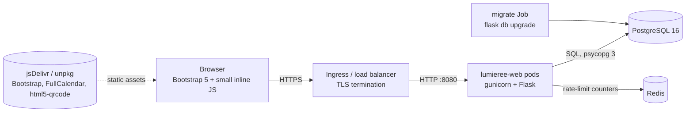
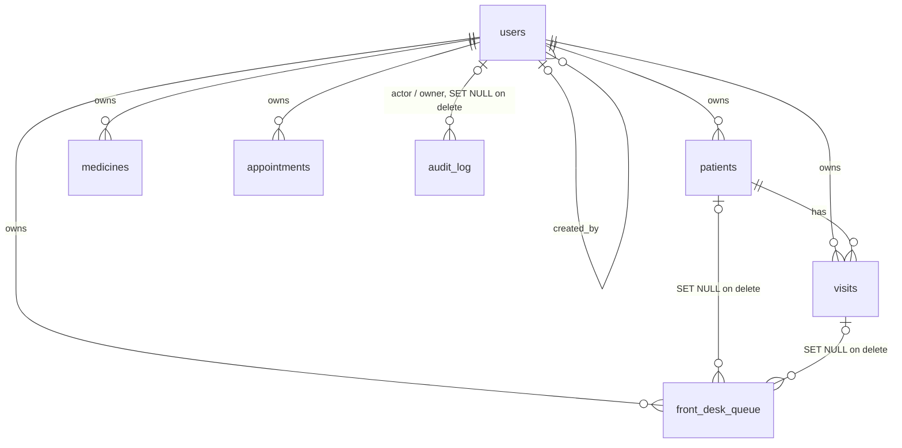
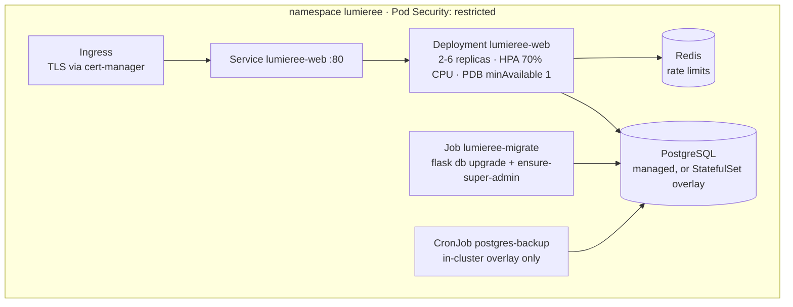

# Lumieree – Architecture

> Living document. It describes the code **as it is on this branch**. Any change to the structure, data model,
> configuration, dependencies, or deployment must update this file in the same change set (see `AGENTS.md`).
> `tests/test_docs.py` fails if a route, table, or environment variable is missing from the sections below.

Last reviewed: 2026-11-08 · Product requirements: [`PRD.md`](PRD.md)

## 1. System context

Lumieree is a multi-tenant point-of-sale web application for Traditional Chinese Medicine (TCM) clinics: patient
records, visits, prescriptions, a front-desk dispensing queue, medicine inventory, appointments, receipts (PDF) and a
simple dashboard. It is a server-rendered Flask application backed by PostgreSQL.



There is no separate API tier and no JavaScript framework. A handful of JSON endpoints (`/api/medicines`,
`/appointments/json`, `/appointments/event_counts`) support autocomplete and the calendar.

**Tenancy model.** A *tenant* is a user account: every business row carries `owner_id` referencing `users.id`, and
every query is scoped to the logged-in account. Super admins manage accounts but their own data is separate too.

## 2. Technology stack

| Concern | Choice |
| --- | --- |
| Language / framework | Python 3.13, Flask 3.1 (application factory + blueprints) |
| Database | PostgreSQL 16 via SQLAlchemy 2.0 (`Mapped[]` style) and psycopg 3; Flask-SQLAlchemy 3.1 |
| Migrations | Alembic through Flask-Migrate (`migrations/`) |
| Auth | Server-side accounts in PostgreSQL, Werkzeug scrypt password hashes, signed cookie session, optional TOTP two-factor (RFC 6238, stdlib; QR codes via `segno`) |
| CSRF / rate limiting | Flask-WTF `CSRFProtect`; Flask-Limiter (memory or Redis storage) |
| PDF receipts | ReportLab (CJK via bundled CID font `STSong-Light`, or Noto Sans CJK when `FONT_DIR` provides it) |
| Front end | Jinja2 templates, Bootstrap 5.3 (CDN), FullCalendar 6 (CDN), html5-qrcode (CDN) |
| Serving | gunicorn (3 workers × 2 threads by default), non-root container, port 8080 |
| Packaging / deploy | Docker multi-stage image, docker-compose (local), Kubernetes manifests with kustomize |
| Quality | pytest (SQLite by default, PostgreSQL in CI), ruff, GitHub Actions (actions pinned to commit SHAs), Trivy scans, Dependabot |

## 3. Repository layout

```
wsgi.py                      WSGI entrypoint (gunicorn wsgi:app, flask --app wsgi)
lumieree/
  __init__.py                create_app(): config, proxy fix, extensions, blueprints, CSP nonce + headers, error handlers
  config.py                  Environment-driven Config / TestingConfig and production safety checks
  extensions.py              db, migrate, csrf, limiter singletons (timestamptz type map)
  models.py                  SQLAlchemy models + tenant-scoping helpers
  auth.py                    Login (+ second factor), logout, settings, MFA setup/disable, session loading, role decorators, user creation/validation
  audit.py                   record(): append-only audit trail (who, what, which record, from which IP)
  mfa.py                     TOTP (RFC 6238) and single-use recovery codes, standard library only
  i18n.py, translations.py   en/zh language switch, t() helper, UI strings, service catalog
  utils.py                   Parsing/validation helpers, CSV formula guard, safe-redirect check
  cli.py                     flask create-super-admin | ensure-super-admin | import-firestore
  legacy_import.py           One-off Firestore -> PostgreSQL import (firebase_admin only needed at run time)
  blueprints/
    health.py                /healthz, /readyz
    inventory.py             Medicines CRUD, stock adjustment, CSV import
    patients.py              Patients CRUD, visits (drafts, confirmation, queue hand-off), per-patient JSON export
    front_desk.py            Dispensing queue: complete (deduct stock) / void (restore stock)
    receipts.py              Receipt page and server-priced PDF
    appointments.py          Day-by-day appointment grid and calendar counts
    admin.py                 Dashboard, CSV exports, audit log viewer, super-admin user management (incl. 2FA reset)
templates/                   Jinja2 pages (layout.html + one template per page, error.html)
migrations/                  Alembic environment and versions/
tests/                       pytest suite (auth, authorization, tenant isolation, features, security hardening, legacy import, docs)
k8s/base, k8s/overlays/, k8s/addons/  Kubernetes manifests: base, overlays (production, in-cluster-postgres, aws-k3s), cert-manager issuers (section 9)
scripts/check_docs_updated.py  Docs-sync gate used by CI, git hook and the Claude Code Stop hook
.github/workflows/ci.yml     Lint, tests (PostgreSQL), migration round-trip, docs gate, Trivy (repo + image), image build
.github/dependabot.yml       Weekly update PRs for pip, GitHub Actions and Docker base images
.github/workflows/zap-baseline.yml  Manual passive OWASP ZAP scan of the production site (report attached to the run)
deploy/deploy.sh             Release script run on the server: migrate -> roll out -> verify -> smoke test -> rollback on failure
deploy/ssm-document.json     AWS Systems Manager document `lumieree-deploy` (input: a 40-character git SHA only)
deploy/site.env              SITE_HOST: the one place the public hostname is defined (deploy script, CI smoke test, ZAP)
deploy/rollback-drill.sh     Rollback drill on a throwaway namespace (bad image + never-ready pod, probed continuously)
Dockerfile, docker-compose.yml, .dockerignore
```

## 4. Request lifecycle

1. **ProxyFix** (only when `TRUSTED_PROXY_COUNT > 0`) restores client IP / scheme / host from `X-Forwarded-*`.
2. `i18n._set_language` stores `g.lang` from the session.
3. `auth._load_user` reads `uid` and `sv` from the signed session, loads the `User` row **on every request** and
   accepts it only if the account is `active` and `users.session_version == session["sv"]`. Anything else clears the
   session. Endpoints outside `OPEN_ENDPOINTS` redirect to `/login`; accounts flagged `must_change_password` are
   confined to `/settings` and `/logout`. If an account has two-factor on, a correct password only parks the login
   (`mfa_uid`, 5-minute expiry, 5 tries) until `/login/mfa` accepts a TOTP or recovery code; only then is `uid` set.
4. **CSRF** (Flask-WTF) validates the token on every non-safe method. Forms carry `csrf_token`; `fetch` calls send
   `X-CSRFToken` read from `<meta name="csrf-token">`.
5. **Rate limiting** applies to `POST /login`, `POST /login/mfa` and the MFA enable/disable routes (`LOGIN_RATE_LIMIT`).
6. The view runs. Role checks use `@admin_required` / `@super_admin_required`; data access always goes through
   `Model.owned_by(owner_id)` / `Model.get_owned(owner_id, id)`.
7. `after_request` adds security headers (CSP with a per-request nonce, `X-Frame-Options: DENY`, `nosniff`,
   `Referrer-Policy`, `Permissions-Policy`, HSTS in production, `Cache-Control: no-store` for non-static responses).
   A first `before_request` hook creates the nonce; templates put it on every inline `<script nonce="{{ csp_nonce }}">`.
8. Error handlers render `error.html` (or JSON for `/api/*` and the appointment JSON endpoints); unhandled
   exceptions are logged and return a generic 500 without internals.

## 5. Route inventory

All routes except those marked *public* require a logged-in, active account. `POST` routes require a CSRF token.

| Route | Methods | Access | Purpose |
| --- | --- | --- | --- |
| `/` | GET | user | Redirect to the patient list |
| `/login` | GET, POST | public | Sign in (rate limited, generic error message; audited) |
| `/login/mfa` | GET, POST | public | Second step for accounts with two-factor: TOTP or one-time recovery code (needs a pending password step) |
| `/logout` | GET | public | Clear the session |
| `/settings` | GET, POST | user | Change own e-mail / password (current password required); two-factor status and set-up |
| `/settings/mfa/start` | POST | user | Begin two-factor set-up (new secret kept in the session until confirmed) |
| `/settings/mfa/enable` | POST | user | Confirm with a code, turn two-factor on, show recovery codes once |
| `/settings/mfa/disable` | POST | user | Turn two-factor off (needs current password and a code) |
| `/switch_language` | POST | public | Toggle English / Chinese; `next` must be a relative path |
| `/healthz` | GET | public | Liveness probe |
| `/readyz` | GET | public | Readiness probe (checks the database) |
| `/patients` | GET | user | List / search patients (name, contact, NRIC) |
| `/patients/add` | GET, POST | user | Create patient |
| `/patients/edit/<int:patient_id>` | GET, POST | user | Edit patient (whitelisted fields) |
| `/patients/delete/<int:patient_id>` | POST | user | Erase patient and their visits (audited) |
| `/patients/<int:patient_id>/export.json` | GET | user | Download everything held about one patient (record + visits) as JSON (audited) |
| `/patients/<int:patient_id>/visits` | GET, POST | user | Visit history (view is audited); save draft / confirm visit |
| `/inventory` | GET | user | List / search medicines |
| `/inventory/add` | GET, POST | user | Create medicine |
| `/inventory/edit/<int:medicine_id>` | GET, POST | user | Edit medicine |
| `/inventory/delete/<int:medicine_id>` | POST | user | Delete medicine |
| `/inventory/adjust/<int:medicine_id>/increase` | POST | user | +1 stock |
| `/inventory/adjust/<int:medicine_id>/set` | POST | user | Set stock |
| `/inventory/scan-combined` | POST | user | Adjust stock by barcode |
| `/inventory/import_csv` | POST | user | Bulk create/update medicines from CSV |
| `/api/medicines` | GET | user | JSON medicine list for the visit autocomplete |
| `/front_desk` | GET | user | Waiting / completed prescription queue |
| `/front_desk/update/<int:queue_id>/<status>` | POST | user | `completed` (deduct stock once) or `void` (restore) |
| `/receipt/queue/<int:queue_id>` | GET | user | Receipt page for a queue item |
| `/generate_receipt_pdf` | POST | user | PDF built from server-side prices |
| `/appointments` | GET | user | Appointment grid for a date + calendar |
| `/appointments/save` | POST | user | Replace a day's appointments |
| `/appointments/delete` | POST | user | Cancel one patient's appointment (204) |
| `/appointments/json` | GET | user | JSON for one day |
| `/appointments/event_counts` | GET | user | JSON booking counts for the calendar |
| `/admin/dashboard` | GET | admin | Counts, visits in a date range, low stock, recent orders |
| `/admin/export/visits.csv` | GET | admin | Visits export (formula-safe) |
| `/admin/export/queue.csv` | GET | admin | Queue export (formula-safe) |
| `/admin/audit` | GET | admin | Audit log, newest first, filter by event prefix, paged; a clinic sees its own account, a super admin sees all |
| `/admin/users` | GET | super admin | Account list |
| `/admin/users/create` | GET, POST | super admin | Create `staff`/`admin` account (temporary password) |
| `/admin/users/<int:uid>/edit` | GET, POST | super admin | Role, active flag, e-mail, reset password, reset two-factor |
| `/admin/users/<int:uid>/delete` | POST | super admin | Delete account and all of its data |
| `/static/<path:filename>` | GET | public | Static files |

CLI commands (`flask …`): `create-super-admin`, `ensure-super-admin` (idempotent bootstrap from
`BOOTSTRAP_ADMIN_*`), `reset-mfa` (break-glass: turn off one account's two-factor, audited), `import-firestore`, and the
Flask-Migrate group `db`.

## 6. Data model



| Table | Key columns / notes |
| --- | --- |
| `users` | `username` (unique, lower-case), `email` (unique, optional), `password_hash` (scrypt), `role` ∈ {`staff`,`admin`,`super_admin`}, `active`, `must_change_password`, `session_version`, `created_by_id`, `last_login_at`, `totp_secret`, `mfa_enabled`, `mfa_last_step` (blocks code re-use), `mfa_backup_codes` (JSONB list of SHA-256 hashes) |
| `audit_log` | Append-only: `created_at`, `actor_id` and `owner_id` (both SET NULL on user delete), `actor_username`, `action` (e.g. `auth.login`, `patient.view`, `patient.export`), `target_type`, `target_id`, `detail`, `ip`; indexes `(owner_id, created_at)`, `created_at`, `action`. The app never updates or deletes rows |
| `patients` | `owner_id`, `name`, `nric`, `dob`, `gender`, `contact`, `email`, `address`, `conditions` (JSONB: condition → Yes/No), `taking_western_medicine`, `western_medicine_duration`, `other_conditions`, `drug_allergies`, `last_visit_at`; index `(owner_id, name)`, `(owner_id, nric)` |
| `visits` | `owner_id`, `patient_id` (CASCADE), `date`, `condition`, `notes`, `discharge_advice`, `status` ∈ {`draft`,`confirmed`}, `prescribed_meds` (JSONB snapshot), `services` (JSONB snapshot of name + amount), `created_at`; index `(owner_id, date)` |
| `medicines` | `owner_id`, `sku_id` (unique per owner), `name`, `english_name`, `company`, `type` (`pills`/`grams`/`bottle`/legacy values), `barcode`, `price` NUMERIC(10,2) ≥ 0, `stock` ≥ 0, `expiry_date`; one row per batch |
| `front_desk_queue` | `owner_id`, `patient_id` and `visit_id` (SET NULL), `items` (JSONB snapshot), `status` ∈ {`waiting`,`completed`}, `stock_deducted`, `created_at` |
| `appointments` | `owner_id`, `date`, `patient_name`, `contact`, `slots` (JSONB hour → text, hours 10–20); index `(owner_id, date)` |

Rules:

* All `owner_id` foreign keys use `ON DELETE CASCADE`, so deleting an account removes its data in one statement.
* Timestamps are `timestamptz`; money is `NUMERIC`; check constraints enforce non-negative price/stock and the
  status/role vocabularies.
* Prescription lines and services are **snapshots** (JSONB) so historical visits and receipts do not change when the
  catalogue changes. Receipt *prices*, however, are recomputed from current medicine prices at print time.
* The legacy Firestore `prescriptions` collection (no UI) has no table.

## 7. Security architecture

| Threat | Control |
| --- | --- |
| Cross-tenant access (IDOR) | `owner_id` on every row; `owned_by` / `get_owned` helpers; foreign ids in visit payloads are dropped; covered by `tests/test_tenant_isolation.py` |
| Session forgery | `SECRET_KEY` required (≥ 32 chars) in production, app refuses to start otherwise; cookies are `HttpOnly`, `SameSite=Lax`, `Secure` in production, 8 h lifetime |
| Stale privileges | User row re-read each request; `session_version` bumped on password/role/active change |
| Brute force | Login rate limit (Redis-backed when multiple replicas), generic error, dummy hash for unknown users, scrypt hashing, password length ≥ 12 |
| CSRF | Flask-WTF on all unsafe methods; state-changing GET routes were converted to POST |
| XSS | Jinja autoescape; DOM APIs instead of string-built HTML in the appointments page; CSP `script-src` has no `'unsafe-inline'`: inline scripts need the per-request nonce and inline event handlers are not used (`data-*` attributes instead); `tests/test_security_hardening.py` scans templates for violations |
| Tampered CDN assets | Every third-party `<script>` / `<link>` carries a Subresource Integrity hash (`integrity` + `crossorigin`); CI test fails if one lacks it |
| Stolen password | TOTP second factor, **mandatory for `admin` and `super_admin` accounts** (`REQUIRE_MFA_FOR_ADMINS`, on by default in production: until it is set up they can only reach Settings and Logout, and they cannot turn it off) and optional for staff (30 s step, ±1 step drift, each code usable once), 8 single-use recovery codes stored as hashes, 5-minute / 5-try pending login, rate limits, super-admin reset path and the `flask reset-mfa` break-glass command; enabling or disabling signs out other browsers |
| Brute force noticed late | The `failed-login-alert` CronJob counts `auth.login_failed` + `auth.mfa_failed` audit rows every 5 minutes and publishes an SNS e-mail when there are at least 5 in 5 minutes (top source addresses included); its pod can reach only DNS, PostgreSQL, the metadata service and HTTPS |
| No accountability / forensics | `audit_log` records sign-ins (success, failure, 2FA), password / e-mail / 2FA changes, patient view / create / update / export / erase, receipts, CSV exports and user management with actor, tenant and IP; the viewer is tenant-scoped |
| Compromised CI / supply chain into production | Deploy role trusts only the `main` branch of this repository through OIDC (no stored keys), can only run one SSM document whose only parameter is a validated 40-hex SHA, and the deployed script comes from the reviewed commit; branch protection on `main` (pull request + passing checks) is what makes "merged" mean "reviewed and green"; Trivy and pinned actions limit what CI itself runs |
| Data-subject requests | `/patients/<id>/export.json` (access) and `/patients/delete/<id>` (erasure incl. visits), both audited |
| Mass assignment | Explicit field whitelists per form (`_patient_from_form`, `_medicine_from_form`) |
| Open redirect | `is_safe_next()` for `next` parameters |
| CSV / formula injection | `csv_safe()` on exports; import limited to 2 MB / 5000 rows |
| Price tampering | PDF totals recomputed server-side from the queue item and visit |
| Double dispensing | Row lock (`SELECT … FOR UPDATE`) plus `stock_deducted` flag; atomic `UPDATE` clamped at zero |
| Information leakage | Generic error pages, no stack traces, no debug mode, `Cache-Control: no-store` |
| Secrets | Nothing in the repo; `.gitignore` blocks key files; Kubernetes Secret created out-of-band |
| Container | Non-root UID 10001, read-only root FS, all capabilities dropped, seccomp `RuntimeDefault`, restricted Pod Security |

Known gaps (tracked in PRD §10): `style-src` still allows `'unsafe-inline'` (templates use style attributes); the
TOTP secret is stored unencrypted in PostgreSQL (the database volume is encrypted at rest; encrypting the column would
tie it to a key that must survive `SECRET_KEY` rotation); the audit log has no retention policy or off-database copy;
erasing a patient removes appointment entries by name (and contact number when both sides have one), which is a
heuristic because appointments are free text not linked to patients; the failed-login alert is a simple count
(no per-IP lock-out, and a sustained attack sends an e-mail every 5 minutes); no per-clinic multi-user tenancy.

## 8. Configuration reference

Environment variables read by the application (defaults in `lumieree/config.py`):

| Variable | Default | Purpose |
| --- | --- | --- |
| `APP_ENV` | `development` | `production` enables safety checks and secure cookies |
| `SECRET_KEY` | – | Session/CSRF signing key (required in production) |
| `DATABASE_URL` | local dev URL | PostgreSQL URL; `postgres://` and `postgresql://` are rewritten to the psycopg 3 driver |
| `SESSION_COOKIE_SECURE` | `true` in production | Send the cookie over HTTPS only |
| `SESSION_LIFETIME_SECONDS` | `28800` | Session lifetime |
| `MAX_UPLOAD_BYTES` | `2097152` | Request size limit (CSV import) |
| `RATELIMIT_ENABLED` | `true` | Toggle rate limiting |
| `RATELIMIT_STORAGE_URI` | `memory://` | Use `redis://…` with more than one replica |
| `LOGIN_RATE_LIMIT` | `10 per minute;60 per hour` | Limit on `POST /login` per client IP |
| `TRUSTED_PROXY_COUNT` | `0` | Number of reverse proxies in front of the app |
| `MIN_PASSWORD_LENGTH` | `12` | Password policy |
| `REQUIRE_MFA_FOR_ADMINS` | `true` in production, else `false` | Administrators (`admin`, `super_admin`) must have two-factor authentication on |
| `CLINIC_NAME`, `CLINIC_NAME_ZH`, `CLINIC_REG_NO`, `CLINIC_ADDRESS` | Harmony TCM values | Receipt header text |
| `FONT_DIR` | – | Directory with `NotoSansCJKsc-Regular.otf` / `-Bold.otf` (optional) |
| `LOG_LEVEL` | `INFO` | Root log level |
| `BOOTSTRAP_ADMIN_USERNAME`, `BOOTSTRAP_ADMIN_PASSWORD`, `BOOTSTRAP_ADMIN_EMAIL` | – | Used by `flask ensure-super-admin` |
| `PORT`, `WEB_CONCURRENCY` | `8080`, `3` | Used by the container start command (gunicorn) |
| `TEST_DATABASE_URL` | `sqlite://` | Database for pytest (CI uses PostgreSQL) |

## 9. Deployment architecture



* **Image**: multi-stage `Dockerfile` (builder venv built without pip → slim runtime), non-root, `HEALTHCHECK` on
  `/healthz`. The runtime stage applies Debian security updates (`apt-get upgrade`) and removes pip / setuptools / wheel,
  which the app never uses at run time (they only add attack surface and scanner findings).
  gunicorn runs without the control socket and with `/dev/shm` worker temp files so the root FS can be read-only.
* **Local**: `docker compose up --build` starts PostgreSQL, a one-shot `migrate` service (also bootstraps the first
  super admin from `BOOTSTRAP_ADMIN_*`), then the web service on `localhost:8080`.
* **Kubernetes** (`k8s/`): `base/` (namespace, ServiceAccount without token, ConfigMap, Deployment, Service,
  Ingress, HPA, PDB, NetworkPolicies default-deny + allow-lists, Redis, `secret.example.yaml`, `migrate-job.yaml`),
  `overlays/production` (managed database; host, image tag and replicas patched), `overlays/in-cluster-postgres`
  (adds a PostgreSQL StatefulSet + nightly `pg_dump` CronJob to a PVC) and `overlays/aws-k3s` (see below), plus
  `addons/cluster-issuer.yaml` (Let's Encrypt ClusterIssuers for cert-manager). Manifests are validated against the
  Kubernetes 1.31 schema; `kustomize build` has not been run in CI.
* **AWS reference deployment** (`overlays/aws-k3s`, runbook in `docs/deployment.md`): one EC2 instance (`t3.medium`,
  or `c7i-flex.large` on the AWS Free plan) with an Elastic IP running **k3s** (Kubernetes Secrets encrypted at rest with
  `secrets-encryption`), ingress-nginx (`externalTrafficPolicy=Local` to keep client IPs) and cert-manager
  (Let's Encrypt HTTP-01), DNS via a **DuckDNS** A record to the Elastic IP, PostgreSQL as a StatefulSet on the encrypted
  EBS root volume, and a nightly CronJob (`postgres-backup-s3`) that uploads `pg_dump` files to a private, versioned,
  encrypted **S3** bucket using the instance's IAM role (IMDSv2, hop limit 2; only the backup pod may reach the metadata
  service). Extra NetworkPolicies allow the cert-manager solver and the backup pod. Single node = no high availability.
  **Admin access** is through AWS Systems Manager Session Manager (the instance role carries
  `AmazonSSMManagedInstanceCore`); the security group opens only 80 and 443, **not 22**. Daily EBS snapshots (Data
  Lifecycle Manager, 7 kept, volume tag `Backup=lumieree-daily`), a CloudTrail trail (multi-region, log validation,
  private bucket) and a Route 53 health check on `/healthz` with a CloudWatch alarm e-mailing an SNS topic
  (`lumieree-alerts`) provide recovery, audit and uptime alerting. The `failed-login-alert` CronJob (`lumieree-alert`
ConfigMap holds the topic, window and threshold) uses the instance role's `sns:Publish` on that topic. The PostgreSQL
pod runs with a **read-only root filesystem** (writable: the data volume, the socket directory and `/tmp`). The public
hostname is defined once in `deploy/site.env`; moving to a purchased domain is a DNS record plus a one-line change
(runbook §18).
* **Release pipeline (CD)**: every commit merged to `main` that passes the CI jobs is deployed automatically
  (details in §11). The `deploy` job assumes an AWS role through GitHub OIDC and runs the SSM document
  `lumieree-deploy` with the commit SHA; the server fetches that exact commit and runs `deploy/deploy.sh`, which checks
  the image is published, runs the migration Job, applies the overlay with the SHA as image tag, verifies the Deployment
  runs that image, smoke-tests `/readyz` and `/healthz` through the ingress, and runs `kubectl rollout undo` if the
  rollout or smoke test fails. The runbook's manual steps remain the fallback.
* **Migrations** run as a separate Job **before** a rollout (never at web start-up) so replicas cannot race.
  Rolling updates use `maxUnavailable: 0`; schema changes must therefore be backward compatible for one release
  (expand → deploy → contract).
* **Scaling**: the web tier is stateless (sessions are signed cookies); shared state lives in PostgreSQL and Redis.
* **Secrets**: `lumieree-secrets` (`SECRET_KEY`, `DATABASE_URL`, bootstrap admin) and, for the in-cluster overlay,
  `postgres-credentials`, created out-of-band (Sealed Secrets / External Secrets / SOPS recommended).
* **Operations**: see `docs/deployment.md` for the step-by-step runbook, rollback and backup/restore.

## 10. Observability

Structured-enough text logs to stdout (`LOG_LEVEL`), including login success/failure with username and client IP,
gunicorn access logs, and stack traces for unhandled exceptions. Probes: `/healthz` (process), `/readyz` (database).
Security-relevant events and access to patient records are also stored in the `audit_log` table (viewer at
`/admin/audit`). On AWS an external Route 53 health check alarms by e-mail when `/healthz` fails. There is no metrics
endpoint or tracing yet (PRD §10).

## 11. Testing and CI

* `pytest` runs against SQLite by default and PostgreSQL when `TEST_DATABASE_URL` is set (CI). The suite covers
  authentication, authorization, tenant isolation (IDOR, mass assignment), dispensing/stock invariants, receipts,
  CSV import/export safety, XSS escaping, rate limiting, two-factor login (replay, lock-out, recovery codes, reset),
  the audit log, CSP nonce / SRI, patient export and erasure, the Firestore import mapping, and docs/code consistency.
* CI (`.github/workflows/ci.yml`): `ruff check` + `ruff format --check`, `pytest` on PostgreSQL **and a Redis service**
  (`tests/test_ratelimit_redis.py` proves the Redis-backed login rate limit with the real client), a migration
  round-trip (`upgrade` → `check` → `downgrade base` → `upgrade`), the docs-sync gate on pull requests, a Trivy
  filesystem scan (dependencies, secrets, Dockerfile / Kubernetes misconfiguration; fails on fixable HIGH/CRITICAL;
  reviewed exceptions live in `.trivyignore.yaml`, each with a reason),
  and the container image build with a Trivy image scan before it is pushed to GHCR from `main` (the owner name is
  lower-cased because registry names must be). GitHub Actions are pinned to commit SHAs and the Dockerfile and CI
  PostgreSQL base images to digests; `.github/dependabot.yml` opens weekly update PRs (pip, Actions, Docker).
* **Continuous deployment**: the `deploy` job in `ci.yml` (`needs: [test, trivy-fs, image]`, only for pushes to `main`,
  serialised by a `production-deploy` concurrency group that never cancels a running deploy) requests
  `id-token: write`, assumes `lumieree-github-deploy` (OIDC trust limited to `repo:Ryan-wong123/Lumieree:ref:refs/heads/main`;
  permission only to run the `lumieree-deploy` SSM document on the one instance, plus read command results) and waits for
  the command. It then smoke-tests the public site (`/readyz`, `/healthz`, HTTP -> HTTPS 308, nonce CSP). No AWS keys are
  stored in GitHub. `tests/test_deploy_config.py` pins these properties (valid script, SHA-only document, gated
  keyless job, full-name image override).
* `deploy/rollback-drill.sh` (run manually on the server) rehearses a failed release on a throwaway namespace: a bad
  image and a never-ready pod are rolled back with the same `kubectl rollout undo` sequence as `deploy.sh` while the
  service is probed every half second (it must answer with the old version, with zero failed probes).
* `.github/workflows/zap-baseline.yml` (manual) runs a passive OWASP ZAP baseline scan against the production URL; it
  covers the unauthenticated pages only (it does not log in), so authenticated pages rely on the tests above.

## 12. Migration from Firebase

The previous version used Firebase Authentication and Firestore. `flask import-firestore --credentials <key.json>`
(`lumieree/legacy_import.py`) copies users, patients, visits, medicines, queue items and appointments in one
transaction (`--dry-run` rolls back). Firebase password hashes are not exported, so each user receives a random
temporary password (written to a mode-600 CSV) and must set a new one at first login. Legacy `prescriptions` are not
migrated. The Firebase service-account key that used to live in the repository must be revoked (it remains in git
history).

## 13. Decision log

| Decision | Rationale |
| --- | --- |
| Keep server-rendered Flask + Jinja | Smallest change that satisfies the product; no SPA rewrite needed |
| Tenant = user account (`owner_id`) | Preserves the existing data model; multi-user clinics are future work |
| JSONB snapshots for visit meds/services and queue items | Matches the original document shape; histories stay immutable |
| Roles: dashboard/exports need `admin`; user management needs `super_admin` | The original `/admin` area was reachable by everyone; the unused `require_admin` helper showed the intent |
| Removed the unreachable `/prescriptions/create` and `/receipt/<prescription_id>` routes | Template never existed; flow replaced by visits → front desk queue |
| Migrations as a Job, not at start-up | Avoid races between replicas |
| Redis only for rate limiting | Required for correct limits across replicas; holds no patient data |
| AWS reference deployment = EC2 + k3s + S3 + DuckDNS (not EKS/RDS) | Cheapest way to run real Kubernetes for one clinic; S3 gives durable off-instance backups; EKS + RDS remain the upgrade path for HA |
| Backups via IAM instance role, not stored AWS keys | No long-lived credentials in the cluster; NetworkPolicy limits metadata-service access to the backup pod |
| TOTP implemented with the standard library; QR codes via `segno` | RFC 6238 is ~40 lines and avoids a heavy dependency; `segno` is pure Python with no dependencies |
| TOTP secrets stored unencrypted in the database | An encryption key would have to survive `SECRET_KEY` rotation and live next to the database credentials anyway; revisit with a KMS-backed key |
| Two-factor optional per account, not enforced | Avoids locking out existing users; a super admin can reset it. Enforcement for admins is a roadmap item |
| Audit log in PostgreSQL, append-only by convention, `SET NULL` foreign keys | Survives user deletion without a separate service; the attempted name of an unknown user is never stored |
| CSP nonces instead of extracting all inline scripts | Smallest change that removes `'unsafe-inline'` from `script-src`; inline handlers replaced by `data-*` attributes |
| Overlay `images:` entries match the full image name, not `lumieree` | The base already renames `lumieree` to `ghcr.io/ryan-wong123/lumieree:latest`; an overlay entry still matching `lumieree` finds nothing and silently keeps `:latest`. The runbook now checks the running image after a deploy |
| CD through an SSM document + OIDC role, not SSH or stored keys | Port 22 is closed; SSM is already the admin path and is audited in CloudTrail. A custom document with a regex-validated SHA parameter means a stolen CI token can only deploy a commit, not run arbitrary commands |
| Deploy script lives in the repo and runs from the commit being deployed | One reviewed source of truth; no unmanaged script on the server. Trade-off: whoever can merge to `main` can change what runs as the deploy, hence branch protection |
| Migrate first, then roll out, auto-rollback on failure | Migrations are expand-only so the old version keeps working; if the new version fails its rollout or smoke test, `rollout undo` restores the previous revision (the new schema stays, which the old version tolerates) |
| Every merge to `main` deploys, no manual approval gate | Requested; the safety net is required checks, the smoke test and automatic rollback. A GitHub `production` environment with required reviewers can be added later without changing the pipeline |
| `redis` client held below 8 (7.4.1); Dependabot ignores its major updates | Flask-Limiter's `limits` package declares `redis<8`, and production rate limiting runs on Redis, so an unsupported client could break login with errors. A real-Redis CI test guards the combination |
| PostgreSQL pod runs with a read-only root filesystem (no Trivy exception) | Tested first on a throwaway pod: fresh start, writes, a forced crash and recovery on the existing data, and a write attempt on `/` all behaved correctly. Only `/tmp` needed adding to the existing socket-directory `emptyDir`. The earlier KSV-0014 exception was removed |
| Two-factor mandatory for administrators, with `flask reset-mfa` as break-glass | An administrator account is the highest-value target; enforcement is a setting (`REQUIRE_MFA_FOR_ADMINS`) and a locked-out admin can always be reset by another super admin or through the CLI over Session Manager |
| Failed-login alert as a CronJob that reads the audit log and publishes to SNS | Reuses the proven backup-pod pattern and the existing alert topic; no SMTP credentials in the app, no log-shipping agent. Trade-off: a simple threshold, polled every 5 minutes |
| Appointment entries are erased by name (+ contact) | Appointments are free text with no link to patients; matching on name, and on the contact number when both sides have one, avoids deleting a different person's booking while still removing the erased patient's |
| One `deploy/site.env` for the hostname | The deploy script, the CI smoke test and the ZAP scan can no longer disagree about the site address, and a domain change is a single reviewed edit |
| Rollback drill on a throwaway namespace, not the live site | Proves detection and rollback mechanics (bad image and never-ready pod) under continuous probing without risking the clinic; the migration step and smoke test inside `deploy.sh` are exercised by every real release |
| Session Manager instead of SSH, port 22 closed | Removes the internet-reachable admin port and the moving-IP allow-list; access is controlled by IAM and logged by CloudTrail |
| GuardDuty not enabled | Requires a paid AWS account plan (the Free plan returns `SubscriptionRequiredException`); revisit after upgrading |

## 14. Change log

| Date | Change |
| --- | --- |
| 2026-11-09 | Round-two hardening: `REQUIRE_MFA_FOR_ADMINS` (administrators confined to two-factor set-up, cannot turn it off) and `flask reset-mfa`; `failed-login-alert` CronJob (+ `alert` NetworkPolicy, SNS publish via the instance role); erasing a patient also removes matching appointment entries; PostgreSQL pod read-only root filesystem (tested on a throwaway pod; Trivy exception removed); `deploy/rollback-drill.sh` run and passed; hostname moved to `deploy/site.env` |
| 2026-11-09 | CI actions updated (still pinned to commit SHAs): checkout 7.0.1, setup-python 7.1.0, docker login 4.7.0, build-push 7.4.0, setup-buildx 4.4.1 (applied as one grouped change instead of five Dependabot PRs that would conflict and deploy five times) |
| 2026-11-09 | Python libraries updated: Flask-Limiter 4.1.1, SQLAlchemy 2.1.8, redis 7.4.1 (Dependabot's redis 8.1.0 rejected: outside the range `limits` supports), firebase-admin >=7.7.0 for the one-off import; CI gains a Redis service and a real-Redis rate-limit test; Dependabot ignores redis major updates |
| 2026-11-08 | SSM deploy document uses `sh`-compatible `set -eu` (the first automatic deploy attempt failed on `set -o pipefail` before changing anything; fixed in AWS and in `deploy/ssm-document.json`, with a test); first automatic deploy of `1f688e2` succeeded |
| 2026-11-08 | Continuous deployment: `deploy` job in `ci.yml` (OIDC role `lumieree-github-deploy`, SSM document `lumieree-deploy`), `deploy/deploy.sh` (migrate, roll out, verify image, smoke test, automatic rollback), post-deploy smoke test from the runner, `tests/test_deploy_config.py`; runbook §13 / §17 |
| 2026-11-08 | Fixed the `images:` override in `overlays/production` and `overlays/aws-k3s` (it matched `lumieree`, which the base had already renamed, so the pinned tag was ignored and pods ran `:latest`); runbook verifies the running image |
| 2026-11-08 | Security hardening: optional TOTP two-factor (`/login/mfa`, `/settings/mfa/*`, users columns), `audit_log` table + `/admin/audit`, per-patient export (`/patients/<id>/export.json`), CSP nonce without `'unsafe-inline'` scripts, SRI on CDN assets (dead FullCalendar CSS/locales URLs fixed), Trivy + Dependabot + pinned Actions/base images in CI (Trivy found and the Dockerfile now fixes fixable `zlib1g` and pip-tooling findings in the image), manual ZAP baseline workflow, `segno` dependency, migration `0002_mfa_audit`; AWS: k3s secrets encryption, Session Manager with port 22 closed, daily EBS snapshots, CloudTrail, uptime alarm |
| 2026-11-07 | S3 backup job waits for PostgreSQL (`pg_isready` loop) before `pg_dump`: k3s programs NetworkPolicy allow rules a few seconds after pod start, so the first connection was refused; runbook marked as executed end to end with tested notes (Free-plan instance type, full-SHA image tag) |
| 2026-11-07 | CI image job lower-cases the GitHub owner in the GHCR image name (mixed-case owners made the build fail) |
| 2026-11-07 | Added the AWS reference deployment: `k8s/overlays/aws-k3s` (S3 backup CronJob, extra NetworkPolicies), `k8s/addons/cluster-issuer.yaml`, and a full EC2 + k3s + S3 + DuckDNS runbook in `docs/deployment.md` |
| 2026-11-06 | Migrated from Firebase to PostgreSQL; restructured into an application factory with blueprints; added CSRF, RBAC, rate limiting, security headers, tests, Docker, Kubernetes manifests, CI, and the docs-sync tooling |
