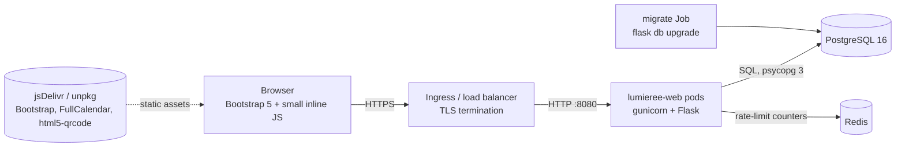
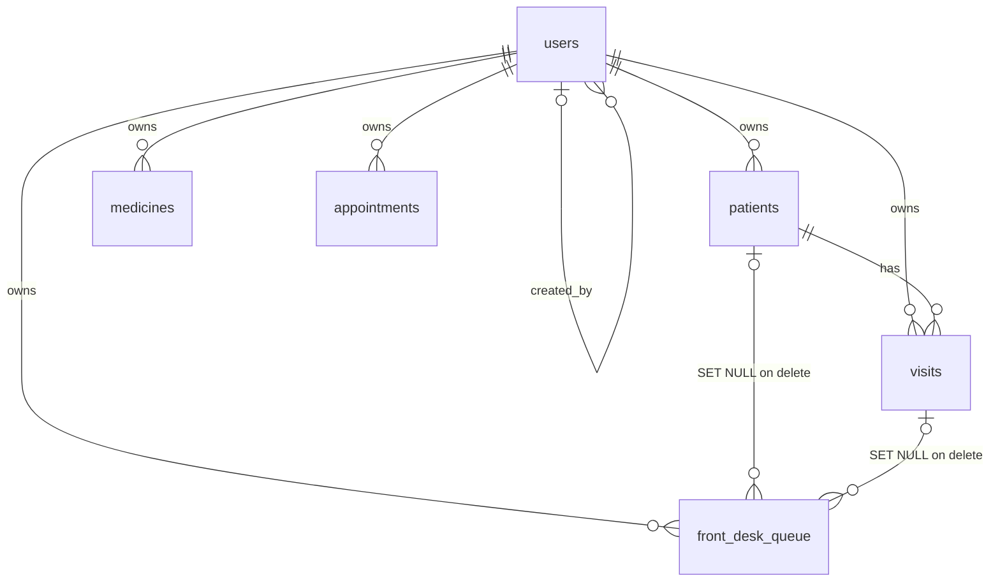
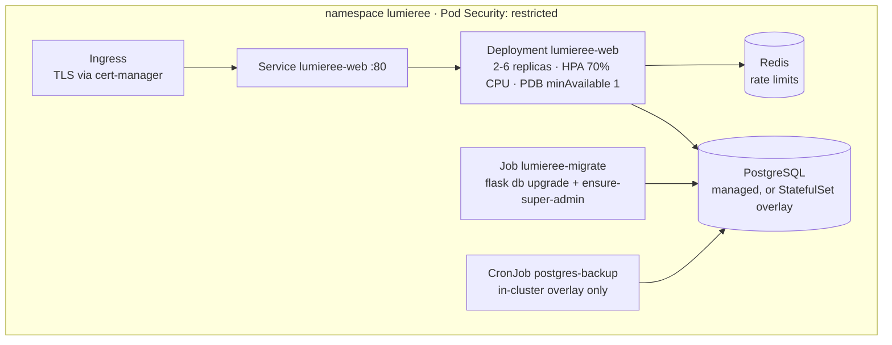

# Lumieree – Architecture

> Living document. It describes the code **as it is on this branch**. Any change to the structure, data model,
> configuration, dependencies, or deployment must update this file in the same change set (see `AGENTS.md`).
> `tests/test_docs.py` fails if a route, table, or environment variable is missing from the sections below.

Last reviewed: 2026-11-07 · Product requirements: [`PRD.md`](PRD.md)

## 1. System context

Lumieree is a multi-tenant point-of-sale web application for Traditional Chinese Medicine (TCM) clinics: patient
records, visits, prescriptions, a front-desk dispensing queue, medicine inventory, appointments, receipts (PDF) and a
simple dashboard. It is a server-rendered Flask application backed by PostgreSQL.



There is no separate API tier and no JavaScript framework. A handful of JSON endpoints (`/api/medicines`,
`/appointments/json`, `/appointments/event_counts`) support autocomplete and the calendar.

**Tenancy model.** A *tenant* is a user account: every business row carries `owner_id` referencing `users.id`, and
every query is scoped to the logged-in account. Super admins manage accounts but their own data is separate too.

## 2. Technology stack

| Concern | Choice |
| --- | --- |
| Language / framework | Python 3.13, Flask 3.1 (application factory + blueprints) |
| Database | PostgreSQL 16 via SQLAlchemy 2.0 (`Mapped[]` style) and psycopg 3; Flask-SQLAlchemy 3.1 |
| Migrations | Alembic through Flask-Migrate (`migrations/`) |
| Auth | Server-side accounts in PostgreSQL, Werkzeug scrypt password hashes, signed cookie session |
| CSRF / rate limiting | Flask-WTF `CSRFProtect`; Flask-Limiter (memory or Redis storage) |
| PDF receipts | ReportLab (CJK via bundled CID font `STSong-Light`, or Noto Sans CJK when `FONT_DIR` provides it) |
| Front end | Jinja2 templates, Bootstrap 5.3 (CDN), FullCalendar 6 (CDN), html5-qrcode (CDN) |
| Serving | gunicorn (3 workers × 2 threads by default), non-root container, port 8080 |
| Packaging / deploy | Docker multi-stage image, docker-compose (local), Kubernetes manifests with kustomize |
| Quality | pytest (SQLite by default, PostgreSQL in CI), ruff, GitHub Actions |

## 3. Repository layout

```
wsgi.py                      WSGI entrypoint (gunicorn wsgi:app, flask --app wsgi)
lumieree/
  __init__.py                create_app(): config, proxy fix, extensions, blueprints, headers, error handlers
  config.py                  Environment-driven Config / TestingConfig and production safety checks
  extensions.py              db, migrate, csrf, limiter singletons (timestamptz type map)
  models.py                  SQLAlchemy models + tenant-scoping helpers
  auth.py                    Login/logout/settings, session loading, role decorators, user creation/validation
  i18n.py, translations.py   en/zh language switch, t() helper, UI strings, service catalog
  utils.py                   Parsing/validation helpers, CSV formula guard, safe-redirect check
  cli.py                     flask create-super-admin | ensure-super-admin | import-firestore
  legacy_import.py           One-off Firestore -> PostgreSQL import (firebase_admin only needed at run time)
  blueprints/
    health.py                /healthz, /readyz
    inventory.py             Medicines CRUD, stock adjustment, CSV import
    patients.py              Patients CRUD and visits (drafts, confirmation, queue hand-off)
    front_desk.py            Dispensing queue: complete (deduct stock) / void (restore stock)
    receipts.py              Receipt page and server-priced PDF
    appointments.py          Day-by-day appointment grid and calendar counts
    admin.py                 Dashboard, CSV exports, super-admin user management
templates/                   Jinja2 pages (layout.html + one template per page, error.html)
migrations/                  Alembic environment and versions/
tests/                       pytest suite (auth, authorization, tenant isolation, features, legacy import, docs)
k8s/base, k8s/overlays/, k8s/addons/  Kubernetes manifests: base, overlays (production, in-cluster-postgres, aws-k3s), cert-manager issuers (section 9)
scripts/check_docs_updated.py  Docs-sync gate used by CI, git hook and the Claude Code Stop hook
.github/workflows/ci.yml     Lint, tests (PostgreSQL), migration round-trip, docs gate, image build
Dockerfile, docker-compose.yml, .dockerignore
```

## 4. Request lifecycle

1. **ProxyFix** (only when `TRUSTED_PROXY_COUNT > 0`) restores client IP / scheme / host from `X-Forwarded-*`.
2. `i18n._set_language` stores `g.lang` from the session.
3. `auth._load_user` reads `uid` and `sv` from the signed session, loads the `User` row **on every request** and
   accepts it only if the account is `active` and `users.session_version == session["sv"]`. Anything else clears the
   session. Endpoints outside `OPEN_ENDPOINTS` redirect to `/login`; accounts flagged `must_change_password` are
   confined to `/settings` and `/logout`.
4. **CSRF** (Flask-WTF) validates the token on every non-safe method. Forms carry `csrf_token`; `fetch` calls send
   `X-CSRFToken` read from `<meta name="csrf-token">`.
5. **Rate limiting** applies to `POST /login` (`LOGIN_RATE_LIMIT`).
6. The view runs. Role checks use `@admin_required` / `@super_admin_required`; data access always goes through
   `Model.owned_by(owner_id)` / `Model.get_owned(owner_id, id)`.
7. `after_request` adds security headers (CSP, `X-Frame-Options: DENY`, `nosniff`, `Referrer-Policy`,
   `Permissions-Policy`, HSTS in production, `Cache-Control: no-store` for non-static responses).
8. Error handlers render `error.html` (or JSON for `/api/*` and the appointment JSON endpoints); unhandled
   exceptions are logged and return a generic 500 without internals.

## 5. Route inventory

All routes except those marked *public* require a logged-in, active account. `POST` routes require a CSRF token.

| Route | Methods | Access | Purpose |
| --- | --- | --- | --- |
| `/` | GET | user | Redirect to the patient list |
| `/login` | GET, POST | public | Sign in (rate limited, generic error message) |
| `/logout` | GET | public | Clear the session |
| `/settings` | GET, POST | user | Change own e-mail / password (current password required) |
| `/switch_language` | POST | public | Toggle English / Chinese; `next` must be a relative path |
| `/healthz` | GET | public | Liveness probe |
| `/readyz` | GET | public | Readiness probe (checks the database) |
| `/patients` | GET | user | List / search patients (name, contact, NRIC) |
| `/patients/add` | GET, POST | user | Create patient |
| `/patients/edit/<int:patient_id>` | GET, POST | user | Edit patient (whitelisted fields) |
| `/patients/delete/<int:patient_id>` | POST | user | Delete patient and their visits |
| `/patients/<int:patient_id>/visits` | GET, POST | user | Visit history; save draft / confirm visit |
| `/inventory` | GET | user | List / search medicines |
| `/inventory/add` | GET, POST | user | Create medicine |
| `/inventory/edit/<int:medicine_id>` | GET, POST | user | Edit medicine |
| `/inventory/delete/<int:medicine_id>` | POST | user | Delete medicine |
| `/inventory/adjust/<int:medicine_id>/increase` | POST | user | +1 stock |
| `/inventory/adjust/<int:medicine_id>/set` | POST | user | Set stock |
| `/inventory/scan-combined` | POST | user | Adjust stock by barcode |
| `/inventory/import_csv` | POST | user | Bulk create/update medicines from CSV |
| `/api/medicines` | GET | user | JSON medicine list for the visit autocomplete |
| `/front_desk` | GET | user | Waiting / completed prescription queue |
| `/front_desk/update/<int:queue_id>/<status>` | POST | user | `completed` (deduct stock once) or `void` (restore) |
| `/receipt/queue/<int:queue_id>` | GET | user | Receipt page for a queue item |
| `/generate_receipt_pdf` | POST | user | PDF built from server-side prices |
| `/appointments` | GET | user | Appointment grid for a date + calendar |
| `/appointments/save` | POST | user | Replace a day's appointments |
| `/appointments/delete` | POST | user | Cancel one patient's appointment (204) |
| `/appointments/json` | GET | user | JSON for one day |
| `/appointments/event_counts` | GET | user | JSON booking counts for the calendar |
| `/admin/dashboard` | GET | admin | Counts, visits in a date range, low stock, recent orders |
| `/admin/export/visits.csv` | GET | admin | Visits export (formula-safe) |
| `/admin/export/queue.csv` | GET | admin | Queue export (formula-safe) |
| `/admin/users` | GET | super admin | Account list |
| `/admin/users/create` | GET, POST | super admin | Create `staff`/`admin` account (temporary password) |
| `/admin/users/<int:uid>/edit` | GET, POST | super admin | Role, active flag, e-mail, reset password |
| `/admin/users/<int:uid>/delete` | POST | super admin | Delete account and all of its data |
| `/static/<path:filename>` | GET | public | Static files |

CLI commands (`flask …`): `create-super-admin`, `ensure-super-admin` (idempotent bootstrap from
`BOOTSTRAP_ADMIN_*`), `import-firestore`, and the Flask-Migrate group `db`.

## 6. Data model



| Table | Key columns / notes |
| --- | --- |
| `users` | `username` (unique, lower-case), `email` (unique, optional), `password_hash` (scrypt), `role` ∈ {`staff`,`admin`,`super_admin`}, `active`, `must_change_password`, `session_version`, `created_by_id`, `last_login_at` |
| `patients` | `owner_id`, `name`, `nric`, `dob`, `gender`, `contact`, `email`, `address`, `conditions` (JSONB: condition → Yes/No), `taking_western_medicine`, `western_medicine_duration`, `other_conditions`, `drug_allergies`, `last_visit_at`; index `(owner_id, name)`, `(owner_id, nric)` |
| `visits` | `owner_id`, `patient_id` (CASCADE), `date`, `condition`, `notes`, `discharge_advice`, `status` ∈ {`draft`,`confirmed`}, `prescribed_meds` (JSONB snapshot), `services` (JSONB snapshot of name + amount), `created_at`; index `(owner_id, date)` |
| `medicines` | `owner_id`, `sku_id` (unique per owner), `name`, `english_name`, `company`, `type` (`pills`/`grams`/`bottle`/legacy values), `barcode`, `price` NUMERIC(10,2) ≥ 0, `stock` ≥ 0, `expiry_date`; one row per batch |
| `front_desk_queue` | `owner_id`, `patient_id` and `visit_id` (SET NULL), `items` (JSONB snapshot), `status` ∈ {`waiting`,`completed`}, `stock_deducted`, `created_at` |
| `appointments` | `owner_id`, `date`, `patient_name`, `contact`, `slots` (JSONB hour → text, hours 10–20); index `(owner_id, date)` |

Rules:

* All `owner_id` foreign keys use `ON DELETE CASCADE`, so deleting an account removes its data in one statement.
* Timestamps are `timestamptz`; money is `NUMERIC`; check constraints enforce non-negative price/stock and the
  status/role vocabularies.
* Prescription lines and services are **snapshots** (JSONB) so historical visits and receipts do not change when the
  catalogue changes. Receipt *prices*, however, are recomputed from current medicine prices at print time.
* The legacy Firestore `prescriptions` collection (no UI) has no table.

## 7. Security architecture

| Threat | Control |
| --- | --- |
| Cross-tenant access (IDOR) | `owner_id` on every row; `owned_by` / `get_owned` helpers; foreign ids in visit payloads are dropped; covered by `tests/test_tenant_isolation.py` |
| Session forgery | `SECRET_KEY` required (≥ 32 chars) in production, app refuses to start otherwise; cookies are `HttpOnly`, `SameSite=Lax`, `Secure` in production, 8 h lifetime |
| Stale privileges | User row re-read each request; `session_version` bumped on password/role/active change |
| Brute force | Login rate limit (Redis-backed when multiple replicas), generic error, dummy hash for unknown users, scrypt hashing, password length ≥ 12 |
| CSRF | Flask-WTF on all unsafe methods; state-changing GET routes were converted to POST |
| XSS | Jinja autoescape; DOM APIs instead of string-built HTML in the appointments page; CSP restricts script/style sources; `data-confirm` instead of inline handlers built from text |
| Mass assignment | Explicit field whitelists per form (`_patient_from_form`, `_medicine_from_form`) |
| Open redirect | `is_safe_next()` for `next` parameters |
| CSV / formula injection | `csv_safe()` on exports; import limited to 2 MB / 5000 rows |
| Price tampering | PDF totals recomputed server-side from the queue item and visit |
| Double dispensing | Row lock (`SELECT … FOR UPDATE`) plus `stock_deducted` flag; atomic `UPDATE` clamped at zero |
| Information leakage | Generic error pages, no stack traces, no debug mode, `Cache-Control: no-store` |
| Secrets | Nothing in the repo; `.gitignore` blocks key files; Kubernetes Secret created out-of-band |
| Container | Non-root UID 10001, read-only root FS, all capabilities dropped, seccomp `RuntimeDefault`, restricted Pod Security |

Known gaps (tracked in PRD §10): CSP still allows `'unsafe-inline'` scripts; CDN assets have no SRI hashes; no
MFA; no audit log table; no per-clinic multi-user tenancy.

## 8. Configuration reference

Environment variables read by the application (defaults in `lumieree/config.py`):

| Variable | Default | Purpose |
| --- | --- | --- |
| `APP_ENV` | `development` | `production` enables safety checks and secure cookies |
| `SECRET_KEY` | – | Session/CSRF signing key (required in production) |
| `DATABASE_URL` | local dev URL | PostgreSQL URL; `postgres://` and `postgresql://` are rewritten to the psycopg 3 driver |
| `SESSION_COOKIE_SECURE` | `true` in production | Send the cookie over HTTPS only |
| `SESSION_LIFETIME_SECONDS` | `28800` | Session lifetime |
| `MAX_UPLOAD_BYTES` | `2097152` | Request size limit (CSV import) |
| `RATELIMIT_ENABLED` | `true` | Toggle rate limiting |
| `RATELIMIT_STORAGE_URI` | `memory://` | Use `redis://…` with more than one replica |
| `LOGIN_RATE_LIMIT` | `10 per minute;60 per hour` | Limit on `POST /login` per client IP |
| `TRUSTED_PROXY_COUNT` | `0` | Number of reverse proxies in front of the app |
| `MIN_PASSWORD_LENGTH` | `12` | Password policy |
| `CLINIC_NAME`, `CLINIC_NAME_ZH`, `CLINIC_REG_NO`, `CLINIC_ADDRESS` | Harmony TCM values | Receipt header text |
| `FONT_DIR` | – | Directory with `NotoSansCJKsc-Regular.otf` / `-Bold.otf` (optional) |
| `LOG_LEVEL` | `INFO` | Root log level |
| `BOOTSTRAP_ADMIN_USERNAME`, `BOOTSTRAP_ADMIN_PASSWORD`, `BOOTSTRAP_ADMIN_EMAIL` | – | Used by `flask ensure-super-admin` |
| `PORT`, `WEB_CONCURRENCY` | `8080`, `3` | Used by the container start command (gunicorn) |
| `TEST_DATABASE_URL` | `sqlite://` | Database for pytest (CI uses PostgreSQL) |

## 9. Deployment architecture



* **Image**: multi-stage `Dockerfile` (builder venv → slim runtime), non-root, `HEALTHCHECK` on `/healthz`.
  gunicorn runs without the control socket and with `/dev/shm` worker temp files so the root FS can be read-only.
* **Local**: `docker compose up --build` starts PostgreSQL, a one-shot `migrate` service (also bootstraps the first
  super admin from `BOOTSTRAP_ADMIN_*`), then the web service on `localhost:8080`.
* **Kubernetes** (`k8s/`): `base/` (namespace, ServiceAccount without token, ConfigMap, Deployment, Service,
  Ingress, HPA, PDB, NetworkPolicies default-deny + allow-lists, Redis, `secret.example.yaml`, `migrate-job.yaml`),
  `overlays/production` (managed database; host, image tag and replicas patched), `overlays/in-cluster-postgres`
  (adds a PostgreSQL StatefulSet + nightly `pg_dump` CronJob to a PVC) and `overlays/aws-k3s` (see below), plus
  `addons/cluster-issuer.yaml` (Let's Encrypt ClusterIssuers for cert-manager). Manifests are validated against the
  Kubernetes 1.31 schema; `kustomize build` has not been run in CI.
* **AWS reference deployment** (`overlays/aws-k3s`, runbook in `docs/deployment.md`): one EC2 `t3.medium` with an
  Elastic IP running **k3s**, ingress-nginx (`externalTrafficPolicy=Local` to keep client IPs) and cert-manager
  (Let's Encrypt HTTP-01), DNS via a **DuckDNS** A record to the Elastic IP, PostgreSQL as a StatefulSet on the encrypted
  EBS root volume, and a nightly CronJob (`postgres-backup-s3`) that uploads `pg_dump` files to a private, versioned,
  encrypted **S3** bucket using the instance's IAM role (IMDSv2, hop limit 2; only the backup pod may reach the metadata
  service). Extra NetworkPolicies allow the cert-manager solver and the backup pod. Single node = no high availability.
* **Migrations** run as a separate Job **before** a rollout (never at web start-up) so replicas cannot race.
  Rolling updates use `maxUnavailable: 0`; schema changes must therefore be backward compatible for one release
  (expand → deploy → contract).
* **Scaling**: the web tier is stateless (sessions are signed cookies); shared state lives in PostgreSQL and Redis.
* **Secrets**: `lumieree-secrets` (`SECRET_KEY`, `DATABASE_URL`, bootstrap admin) and, for the in-cluster overlay,
  `postgres-credentials`, created out-of-band (Sealed Secrets / External Secrets / SOPS recommended).
* **Operations**: see `docs/deployment.md` for the step-by-step runbook, rollback and backup/restore.

## 10. Observability

Structured-enough text logs to stdout (`LOG_LEVEL`), including login success/failure with username and client IP,
gunicorn access logs, and stack traces for unhandled exceptions. Probes: `/healthz` (process), `/readyz` (database).
There is no metrics endpoint or tracing yet (PRD §10).

## 11. Testing and CI

* `pytest` runs against SQLite by default and PostgreSQL when `TEST_DATABASE_URL` is set (CI). The suite covers
  authentication, authorization, tenant isolation (IDOR, mass assignment), dispensing/stock invariants, receipts,
  CSV import/export safety, XSS escaping, rate limiting, the Firestore import mapping, and docs/code consistency.
* CI (`.github/workflows/ci.yml`): `ruff check` + `ruff format --check`, `pytest` on PostgreSQL, a migration
  round-trip (`upgrade` → `check` → `downgrade base` → `upgrade`), the docs-sync gate on pull requests, and the
  container image build (pushed to GHCR from `main`).

## 12. Migration from Firebase

The previous version used Firebase Authentication and Firestore. `flask import-firestore --credentials <key.json>`
(`lumieree/legacy_import.py`) copies users, patients, visits, medicines, queue items and appointments in one
transaction (`--dry-run` rolls back). Firebase password hashes are not exported, so each user receives a random
temporary password (written to a mode-600 CSV) and must set a new one at first login. Legacy `prescriptions` are not
migrated. The Firebase service-account key that used to live in the repository must be revoked (it remains in git
history).

## 13. Decision log

| Decision | Rationale |
| --- | --- |
| Keep server-rendered Flask + Jinja | Smallest change that satisfies the product; no SPA rewrite needed |
| Tenant = user account (`owner_id`) | Preserves the existing data model; multi-user clinics are future work |
| JSONB snapshots for visit meds/services and queue items | Matches the original document shape; histories stay immutable |
| Roles: dashboard/exports need `admin`; user management needs `super_admin` | The original `/admin` area was reachable by everyone; the unused `require_admin` helper showed the intent |
| Removed the unreachable `/prescriptions/create` and `/receipt/<prescription_id>` routes | Template never existed; flow replaced by visits → front desk queue |
| Migrations as a Job, not at start-up | Avoid races between replicas |
| Redis only for rate limiting | Required for correct limits across replicas; holds no patient data |
| AWS reference deployment = EC2 + k3s + S3 + DuckDNS (not EKS/RDS) | Cheapest way to run real Kubernetes for one clinic; S3 gives durable off-instance backups; EKS + RDS remain the upgrade path for HA |
| Backups via IAM instance role, not stored AWS keys | No long-lived credentials in the cluster; NetworkPolicy limits metadata-service access to the backup pod |

## 14. Change log

| Date | Change |
| --- | --- |
| 2026-11-07 | Added the AWS reference deployment: `k8s/overlays/aws-k3s` (S3 backup CronJob, extra NetworkPolicies), `k8s/addons/cluster-issuer.yaml`, and a full EC2 + k3s + S3 + DuckDNS runbook in `docs/deployment.md` |
| 2026-11-06 | Migrated from Firebase to PostgreSQL; restructured into an application factory with blueprints; added CSRF, RBAC, rate limiting, security headers, tests, Docker, Kubernetes manifests, CI, and the docs-sync tooling |
